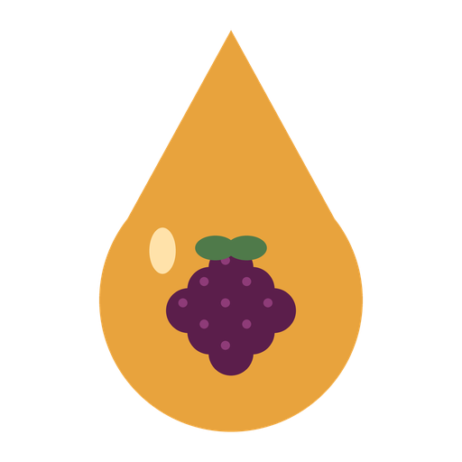
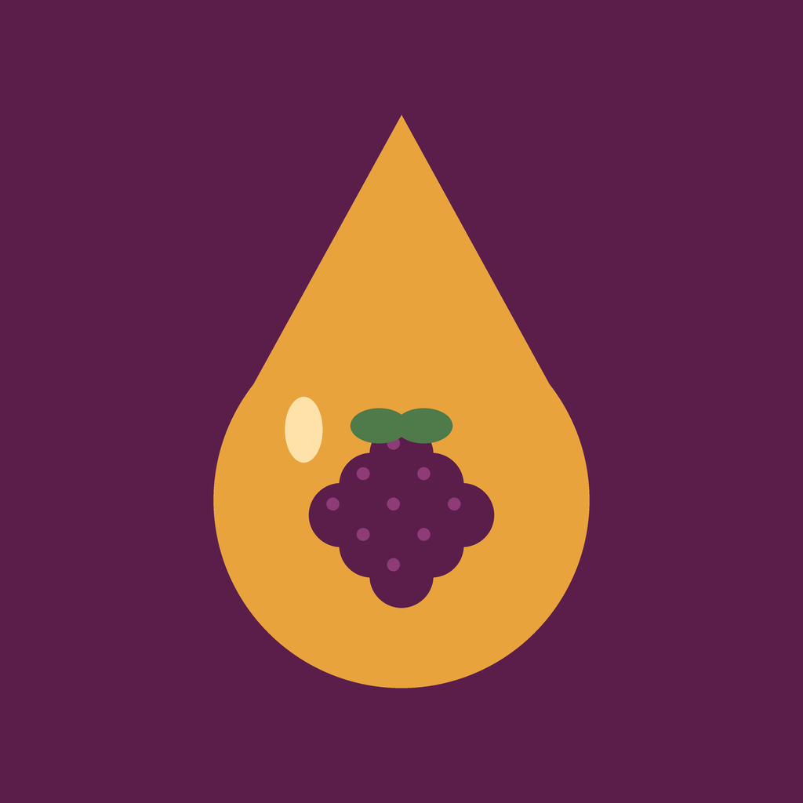
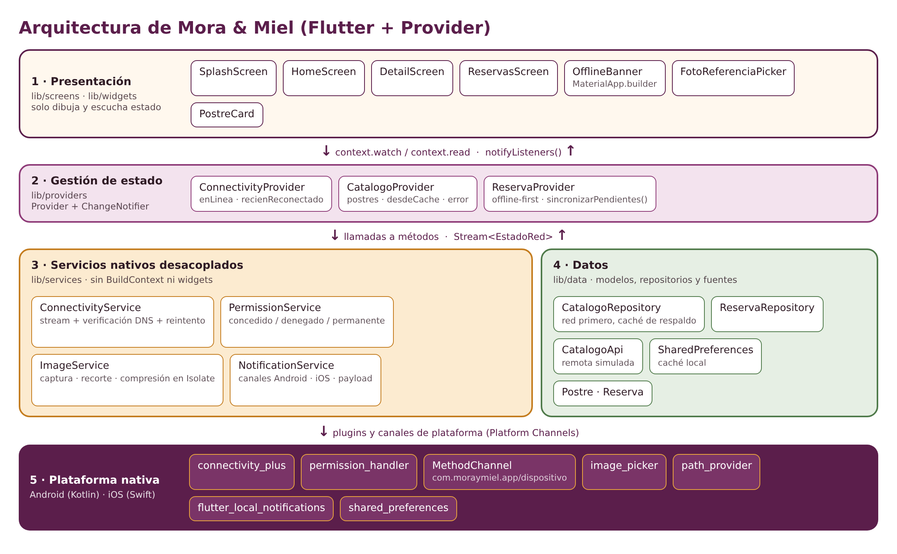

<p align="center">
  
</p>

<h1 align="center">Mora &amp; Miel · Pastelería artesanal</h1>

<p align="center">
  Aplicación Flutter de catálogo y reservas de postres con soporte offline,<br>
  cámara con permisos en tiempo de ejecución y notificaciones locales.<br>
  <b>Actividad Integradora 2</b> · Desarrollo de Aplicaciones Móviles
</p>

> **Origen del proyecto:** esta app es la **reingeniería del proyecto de la Actividad Integradora 1**
> (*Dulce Antojo*, catálogo de postres con 2 pantallas). Se conservó el historial y se evolucionó
> mediante un rebranding completo y la integración de servicios nativos.

---

## 1. Rebranding

| Elemento | Antes (Actividad 1) | Después (Actividad 2) |
|---|---|---|
| Nombre comercial | Dulce Antojo | **Mora & Miel** |
| Package Android | `com.dulceantojo.dulce_antojo` | **`com.moraymiel.app`** |
| Bundle ID iOS | `com.dulceantojo.dulceAntojo` | **`com.moraymiel.app`** |
| Paquete Dart | `dulce_antojo` | `mora_y_miel` (v2.0.0+2) |
| Ícono | Ícono por defecto de Flutter | Gota de miel con mora (legacy + adaptativo) |
| Splash | Fondo blanco vacío | Fondo mora + logo (Android < 12, Android 12+ y iOS) + splash animado en Flutter |
| Paleta | `Colors.pink` repetido en cada widget | Tema central `AppTheme` / `AppColors` |

| Antes | Después |
|:---:|:---:|
|  |  |

**Paleta:** Mora `#5B1E4B` · Mora claro `#8E3B78` · Miel `#E8A33D` · Crema `#FFF8EE` · Cacao `#2E1A24` · Hoja `#4F7A4A` · Alerta `#B3261E`

## 2. Servicios nativos


Eventos que disparan notificaciones: **reserva confirmada**, **reserva guardada sin conexión** y **reservas sincronizadas** al volver internet.

## 3. Arquitectura



- **Presentación** (`screens/`, `widgets/`): solo dibuja y escucha estado.
- **Estado** (`providers/`): `ChangeNotifier` + `provider` (inyección con `MultiProvider` en `main.dart`).
- **Servicios nativos** (`services/`): clases Dart puras, sin `BuildContext`; se pueden probar y reemplazar.
- **Datos** (`data/`): modelos, repositorios y fuentes (API simulada + caché local).

```

## 4. Instalación y ejecución

**Requisitos:** Flutter 3.41 o superior (Dart ≥ 3.12), Android Studio con un emulador (API 24+) o un dispositivo físico. Para iOS: Xcode 16+.


### Configuración extra para iOS (CocoaPods)
`permission_handler` necesita activar los permisos usados en `ios/Podfile` (se genera tras el primer `flutter run`/`pod install`):


## 5. Cómo probar cada servicio (QA)


Comandos útiles: `flutter analyze` (el proyecto no tiene advertencias) y, en el emulador Android, *Extended controls → Cellular/Wi-Fi* o `adb shell svc wifi disable` para simular la pérdida de red.

## 6. Control de versiones

Flujo: `feature/*` → `develop` (merge `--no-ff`) → `main` (release). Mensajes de commit con *Conventional Commits* (`feat`, `refactor`, `style`, `docs`, `chore`).

## 7. Documentación

INFORME EN PDF

## Créditos

- **Autora:** Cinthia Marisol Guamán Montaño
- 
